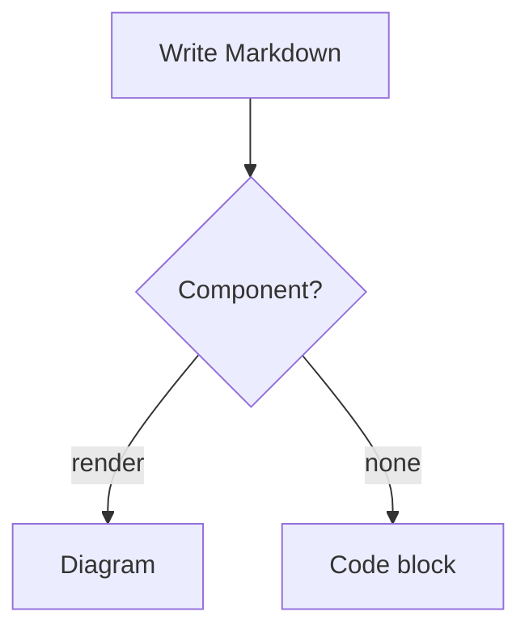

+++
title = "Components: Externals"
date = 2026-04-18
description = "Components that lean on a bundled external library: Mermaid diagrams and KaTeX math notation."

[taxonomies]
tags = ["component", "syntax", "zola"]

[extra]
series = "Components"
series_part = 3
+++

## Render

`render` turns one fenced `mermaid` or `math` block into a diagram or formula.
Both libraries ship with the theme and load only on pages that use them.

inline
: math only — render within a sentence. Default `false`.

Needs `enable_mermaid` / `enable_math` (both on by default). With a flag off,
the block shows as plain source.

### Mermaid


````md



````






### Math


````md

```math
E = mc^2
```

````



```math
E = mc^2
```


Inline:


````md

```math
E = mc^2
```

````


Einstein's mass–energy equivalence, 
```math
E = mc^2
```
, sits in the middle of this sentence.
